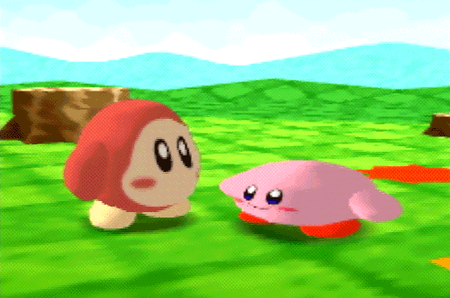
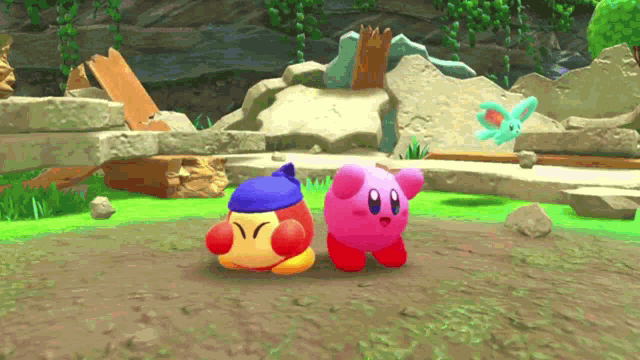

# hiya, i'm andy! 🤙

    → college student interested in game development, product management, & cloud infrastructure ☺︎

 

    
    

## my recent game projects 📀

    → <a target="_blank" rel="noopener noreferrer" href="https://devpost.com/software/crowd-control-xci8fu">Crowd Control</a>, a free alternative to Jackbox Games about a party survival game where spectators can join in through their phones and send waves of chaotic events across the game for Roblox players to survive through!!
     
    → <a target="_blank" rel="noopener noreferrer" href="https://andyjpeg.itch.io/shello-world">Shello, World!</a>, a 3D platformer about SH3LLY, a hermit crab crab girl who just got a delivery job at a small island, collecting shells of code for a certain company(?) to keep the beach up and running! all you need to do is help her retrieve, run, and repeat!
     
    → <a target="_blank" rel="noopener noreferrer" href="https://github.com/andy-jpeg/sasehacks_26">Space Buddies</a>, a 3D platformer about a team of little adorable space aliens exploring the galaxies and must make a pit stop to save a nearby planet from being destroyed by an evil organization!!

## my languages & tools 🧑🏻‍💻

